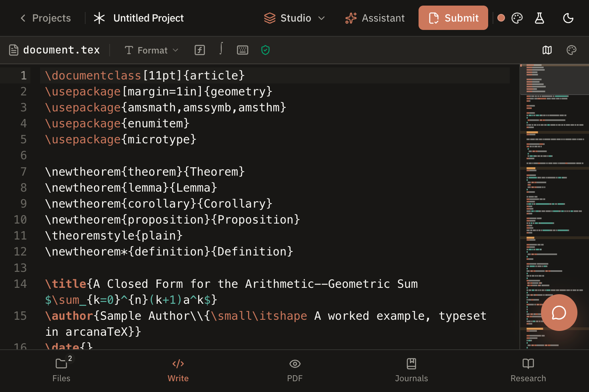
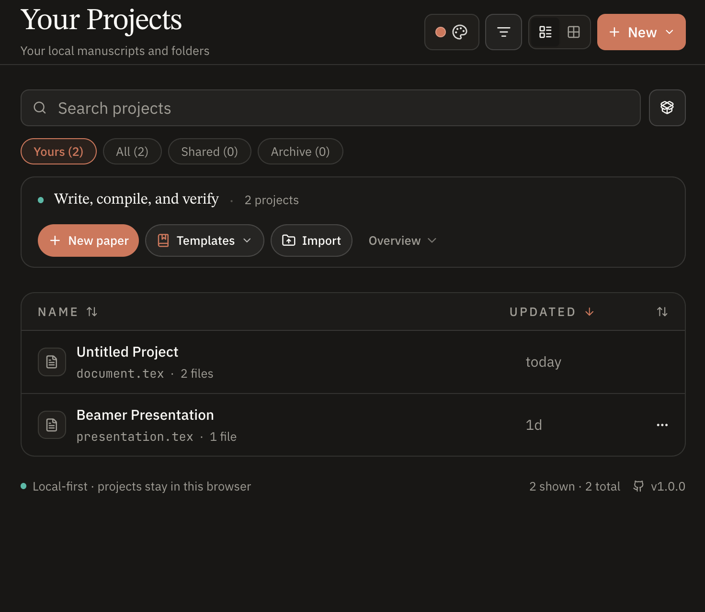
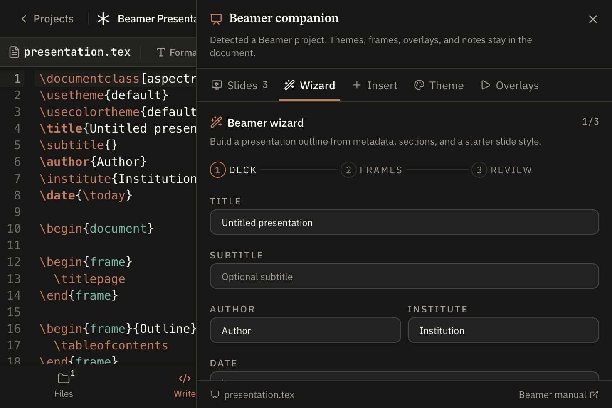
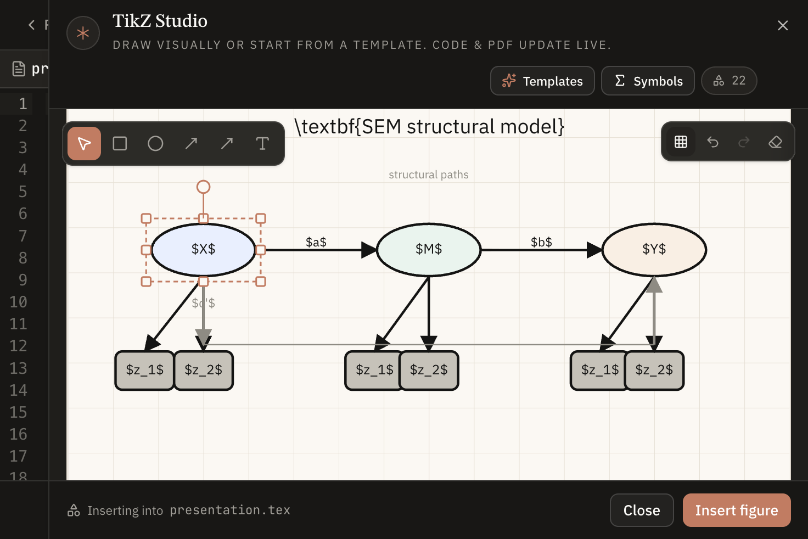
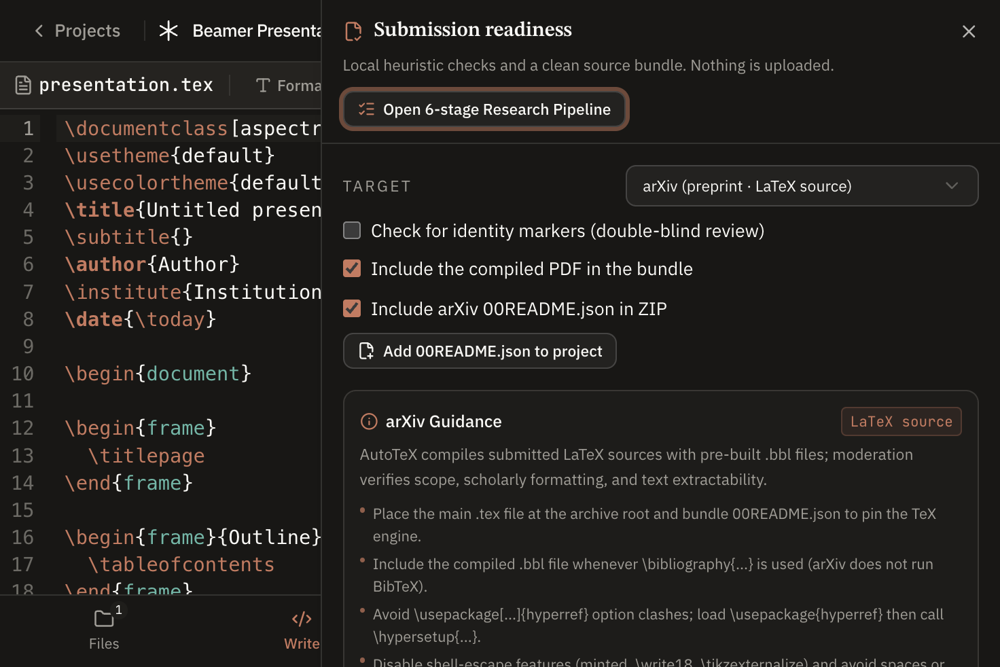

# arcanaTeX

**A browser-based LaTeX and Lean workspace with optional AI assistance.**

**Stable release: v1.0.0** ·
[Release notes](https://github.com/mrphilo420/arcanaTeX/releases/tag/v1.0.0)

Edit multi-file LaTeX projects, compile PDFs, and use optional tools for writing,
review, Lean, figures, and presentations. Projects are stored in browser
IndexedDB. Compilation and model calls use services you configure.

<p align="center">
  
</p>

<p align="center">
  <sub>Edit LaTeX and navigate long documents with the syntax-aware code minimap.</sub>
</p>

## Screenshots

| Project library | Beamer wizard |
| :---: | :---: |
| [](./assets/screenshots/project-library.png) | [](./assets/screenshots/beamer-wizard.png) |
| **TikZ studio** | **Submission readiness** |
| [](./assets/screenshots/tikz-studio.png) | [](./assets/screenshots/submission-readiness.png) |

## Features

- Multi-file LaTeX editing with autosave, live PDF preview, diagnostics, and
  support for pdfLaTeX, XeLaTeX, LuaLaTeX, and Tectonic. See
  [compiler notes](./docs/compiler-best-practices.md).
- Syntax-aware editor minimap with a draggable viewport, cursor tracking, and
  diagnostic markers for LaTeX, Markdown, and Lean files.
- Import archives or folders; organize projects and save local versions.
- Optional AI tools for editing, BibTeX cleanup, paper review, and Lean source
  analysis. Model providers are configurable; see [provider setup](./docs/llm-providers.md).
- Create figures with the TikZ editor or local Python/R tools. Beamer projects
  get a slide editor and presentation wizard.
- Search arXiv, Springer Nature, or Zotero and add references to a `.bib` file.
- Run submission checks and download a source `.zip`.
- Optional WebSocket collaboration. Sync snapshots are stored as unencrypted
  JSON on the API host; secure that host and its storage.
- Edit Markdown and Lean files alongside a LaTeX project.

## Quick start

### Requirements

- Node.js 20+
- pnpm 10+
- TeX Live or MiKTeX for local compilation
- Tectonic 0.16+ (optional; selectable compiler with automatic reruns)
- Python 3.10+ and/or R 4.x (optional; AI computation and TikZ figure tools)
- An OpenAI-compatible model endpoint (optional for AI features)

### Run locally

```bash
# Clone the repository
git clone https://github.com/mrphilo420/arcanaTeX.git
cd arcanaTeX

# Install dependencies
pnpm install

# Copy environment variables
cp apps/web/.env.example apps/web/.env.local

# Configure your environment variables in apps/web/.env.local
# - GROQ_API_KEY: Groq API key (server-side only; preferred when set)
# - GROQ_MODEL: Optional Groq model id (defaults to qwen/qwen3.8-27b)
# - GROQ_BASE_URL: Optional Groq OpenAI-compatible endpoint
# - ZOTERO_API_KEY: Zotero web API key (server-side only)
# - ZOTERO_LIBRARY_TYPE: users or groups
# - ZOTERO_LIBRARY_ID: optional: 0 resolves the key's user automatically
# - OPENAI_API_KEY: OpenAI-compatible fallback (server-side only)
# - OPENAI_MODEL: Optional fallback model id (defaults to gpt-4o)
# - ENABLE_LOCAL_CODE_EXECUTION: Set false to disable AI Python/R execution
# - ALLOW_UNSANDBOXED_CODE_EXECUTION: Non-macOS escape hatch; keep false
# - PYTHON_BIN / R_BIN: Optional interpreter paths for the code tools
# - OPENAI_BASE_URL: Optional OpenAI-compatible endpoint
# - LATEX_API_URL: URL to the LaTeX compilation service
# - KV_REST_API_URL: KV REST API URL (for rate limiting)
# - KV_REST_API_TOKEN: KV REST API token

# Start the web app
pnpm dev:web
```

In a second terminal, start the LaTeX and sync API:

```bash
pnpm --dir apps/latex-api dev
```

The web app runs at `http://localhost:3000`; the LaTeX/sync API runs at
`http://localhost:3001`. See [CONTRIBUTING.md](./CONTRIBUTING.md) for the full
development setup.

## Connecting a model

The chat runs through `apps/web/app/api/chat/route.ts` with the Vercel AI SDK.
The API key stays on the server and is never sent to the browser. Groq is used
when `GROQ_API_KEY` is set; otherwise the OpenAI-compatible fallback is used.

**Groq:**

```bash
GROQ_API_KEY="gsk_..."
GROQ_BASE_URL="https://api.groq.com/openai/v1"
GROQ_MODEL="qwen/qwen3.8-27b"  # or openai/gpt-oss-120b, openai/gpt-oss-20b
```

The model picker in the assistant and developer panel selects the active model.
The server accepts only the curated Groq ids in `apps/web/lib/chat-models.ts`.

**OpenAI:**

```bash
OPENAI_API_KEY="sk-..."
OPENAI_MODEL="gpt-5.2"   # or gpt-4o, o-series, etc.
```

**OpenRouter / any OpenAI-compatible gateway:**

```bash
OPENAI_API_KEY="sk-or-..."
OPENAI_BASE_URL="https://openrouter.ai/api/v1"
OPENAI_MODEL="openai/gpt-5.2"
```

**Local models (Ollama, LM Studio, vLLM):**

```bash
OPENAI_API_KEY="local"                       # placeholder
OPENAI_BASE_URL="http://localhost:11434/v1"  # Ollama
OPENAI_MODEL="qwen3:32b"
```

The AI assistant receives the whole project file list plus the active and main
documents. Frontend tools let it list/read/search/create files, set the main
document, and edit the active document in place.

For Anthropic, Google, or another native API, install the matching AI SDK
provider (for example `@ai-sdk/anthropic`) and swap the provider in
`apps/web/app/api/chat/route.ts`, or put a gateway such as OpenRouter or
LiteLLM in front of it.

## Literature and Zotero

- **arXiv** search needs no key.
- **Springer Nature** search uses the server-side keys in `.env.local`:
  - `SPRINGER_META_API_KEY` for all Springer content
  - `SPRINGER_OPENACCESS_API_KEY` for open-access-only search
- **Zotero** works with either the local Zotero API (Zotero running, local API
  enabled) or the Zotero Web API. Set `ZOTERO_API_KEY` in `.env.local` to use a
  server-side key; the web app resolves the key's user automatically when the
  library id is `0`. A browser-entered key remains available as a fallback.

Adding a reference appends BibTeX to a `.bib` file (creating
`references.bib` if needed) and inserts `\cite{...}`. When it creates the
bibliography file, it also adds `\bibliographystyle{plain}` and
`\bibliography{references}` to the main document if no bibliography is
configured.

## Project library, folders, and versions

The home page keeps project organization local:

- **All Projects** contains everything in this browser. **Your Projects**
  excludes projects opened from a collaborator's sync link; those appear under
  **Shared with you**.
- **Folders** are local collections of projects (they do not move files inside
  a manuscript). Create them from the sidebar or the **New** menu, move projects
  with the row menu, and delete a folder without deleting the projects inside
  it.
- **List view** supports sorting by name or creation date; **grid view** keeps
  the cover-card layout. Search covers project names, paths, and up to 120k
  characters of document text.
- **Versions** live in the workspace Project inspector. Save up to 30 local
  snapshots per project with an optional note, then restore or delete them.
  Snapshots include files, comments, compiler, and main-document selection.

Compile **Logs** are kept for the current session and show engine, timing, file
count, and any captured error output. They are local to the browser and are
cleared when the project is reopened.

## Real-time compile diagnostics and auto-fix

Compilation runs automatically after edits settle (a 1.2 s idle debounce) unless
**Auto** is paused in the PDF toolbar. The compile request asks the LaTeX
service for the full `.log`, and the client parses it into structured
diagnostics.

- Each issue shows its severity, nature (for example *Undefined environment*,
  *Missing figure*, *Environment mismatch*, or *Undefined command*), file/line,
  and a source excerpt.
- Click an issue to jump the editor to that line. The inspector is non-modal,
  so the code and the suggested fix remain visible together.
- The **Suggested fix** panel shows the exact line changes before applying.
  Each error can be repaired with the deterministic rule or the selected AI
  model.
- **Fix all** applies the deterministic rules first, then uses AI for errors and
  high/medium-priority warnings. Overfull hboxes are prioritized: a mild single
  box gets `\setlength{\emergencystretch}{2em}`, repeated or severe boxes get
  `\sloppy`, and the AI is told to add `\-` or `\path` when one unbreakable
  token is wider than the line. A version snapshot is saved before any source
  change, so the result can be restored from **Versions**.
- The warning ranking and remedies live in
  `apps/web/lib/latex-warning-knowledge.ts`. The AI prompt receives only the
  entries for the warnings in the current compile; it is told to omit a patch
  rather than invent a package or command when the knowledge base has no safe
  remedy.
- Every AI repair is also recorded in the Assistant thread: the action, the
  applied patch summary, any rejected patch, and the failure reason. The thread
  auto-opens for the record, persists with the project, and can be cleared from
  the composer with **Clear chat**.
- If a PDF is produced despite compile errors, repairs still run. The document
  is recompiled and the previous state remains available in **Versions**.
- The repair rules cover missing graphics (comment the command), missing
  theorem-like environments (add `\newtheorem`), missing package-provided
  environments/commands (add the package), unbalanced environments (comment
  stray ends or close unclosed blocks), missing `.sty` calls, and simple
  duplicate definitions. Anything without a safe deterministic match is marked
  **Manual**/**Review** and left untouched. The rule contract, current
  implementation gaps, and test-first acceptance matrix are documented in
  [docs/deterministic-repair-rules.md](./docs/deterministic-repair-rules.md).

## Chat, paper review, Lean, and Markdown

The chat composer exposes **Paper writer**, **Review paper**, and **Lean audit**
actions above the input. You can also type a command directly.

### Paper writer

- `/hourglass` starts in `diagnose` mode. Other modes are `outline`, `draft`,
  `revise`, `extract`, and `review`; add a focus such as
  `/hourglass revise discussion`.
- `outline`, `diagnose`, `extract`, and `review` are read-only. `draft` and
  `revise` can edit the manuscript, with changes presented for Keep/Undo.

### Technical paper review

- `/paper-review` checks equations, derivations, notation, units, appendix
  formulas, and quantitative claims, then provides editorial feedback.
- The assistant returns Markdown; the app converts it into a standalone
  compilable LaTeX review at `paper-reviews/review-YYYY-MM-DD-HHMMSS.tex` and
  opens it in the editor. The manuscript itself stays read-only.
- The review separates definite errors, unsupported claims, likely issues, and
  items that need external verification. It never invents citations, results,
  line numbers, or verification evidence.
- Add a focus, for example `/paper-review equations` or
  `/paper-review appendix notation`.

### BibTeX repair

- `/bibtex` reads the `.bib` file, applies the safe mechanical corrections with
  `patch_bibtex`, and returns the remaining warnings.
- `/bibtex report` inspects without writing.
- It normalizes entry syntax and field delimiters, removes duplicate and empty
  fields, fixes single-hyphen pages and month names, strips `doi.org` URLs from
  `doi`, and escapes `&` and `%` in prose fields.
- It reports missing required fields, duplicate citation keys, and
  journal/booktitle mismatches. It never invents bibliographic data; missing
  values must come from the source or from you.
- Use `entryKey` plus the tool's `set`/`remove` fields when you want a specific
  semantic correction. The `.bib` diff opens in the normal Keep/Undo review.
- New-file creation now accepts `.bib` paths, so you can start a bibliography
  from the file tree as well as from the Literature panel.

### Peer review

- `/peer-review` runs a simulated editorial panel in full mode.
- `/peer-review quick`, `/peer-review methodology`, `/peer-review re-review`,
  and `/peer-review guided` select other modes.
- Add a focus after the command, for example `/peer-review lean` or
  `/peer-review statistics`.
- The panel returns read-only feedback from editorial, methodology, domain,
  cross-disciplinary, and devil's-advocate perspectives. Its report stays in
  chat.

### Lean 4

- `.lean` files can be created in the file tree, imported with a folder, edited,
  and included in the project source bundle.
- The **Lean** control in the workspace connects to a local Lake project through
  the API bridge, lists its `.lean` sources, runs `lake build`, and can import
  the sources into the browser project for chat context.
- The editor uses Lean syntax highlighting and suppresses LaTeX-only shortcuts.
- The **Lean Infoview** opens automatically for `.lean` files. It summarizes
  declarations, proof markers, imports, and local messages, and can be hidden,
  reopened from the top bar, or docked left/right. Interactive goal state still
  requires a Lean language server.
- The chat receives Lean declarations, imports, and proof-health summaries; the
  `inspect_lean_sources` tool provides structured details.
- `sorry` and `admit` are treated as incomplete proofs. `axiom`, `opaque`,
  `native_decide`, `unsafe`, and `partial` are surfaced as trust or soundness
  risks.
- arcanaTeX does not bundle a Lean compiler. The optional local bridge can run
  `lake build`; without it, the app only understands and audits Lean source. It
  never claims kernel verification without build evidence.

### Connect a local Lake project

Start the web app and the LaTeX/Lean API locally:

```bash
pnpm dev:web
pnpm --filter @open-prism/latex-api dev
```

The **Lean** panel discovers Lake projects from Elan's known-project registry
and common document folders. If no project is found, enter the absolute project
path in the panel. You can also set a default project when starting the API:

```bash
LEAN_PROJECT_DIR="/absolute/path/to/lake-project" \
  pnpm --filter @open-prism/latex-api dev
```

`LEAN_PROJECT_DIR` supports `~`; set `LAKE_BIN` if Lake is not on `PATH`. The
panel lists installed Elan toolchains. If more than one Lean version is
installed, choose the version explicitly; the project's `lean-toolchain` pin is
preselected when it is available. You can build the project, inspect the file
manifest, and import `.lean` sources into the current browser project. The
bridge accepts only `.lean` reads and a fixed `lake build` command; it never
writes to the local project.

For a non-local deployment, set `LEAN_API_URL` and a matching
`LEAN_BRIDGE_TOKEN` in the web app and API environments. The browser must be able
to reach the bridge; for local-first use, keep both services on the same machine.
Only point the bridge at trusted projects: `lake build` executes the project's
Lakefile and build scripts. Do not expose the bridge without `LEAN_BRIDGE_TOKEN`
and network access controls.

### Markdown

- Open `.md` or `.markdown` files in the workspace editor.
- Use the **Preview** button in the editor toolbar to render GFM tables,
  task lists, math, links, code fences, and images; **Edit** returns to source.
- Markdown headings populate the workspace outline.
- Markdown preview is also useful for review reports and research notes saved
  in the project.

## Beamer presentations

The workspace detects `\documentclass{beamer}`, `\begin{frame}`, or
`\usetheme` and shows a **Beamer** control. The home page's **New** menu can
create a Beamer project with a starter deck.

- **Slides** lists frames parsed from the source; clicking one jumps to it.
- **Wizard** collects title/subtitle/author/institute/date, sections, starter
  frame style, theme, and aspect ratio, previews the exact source, and appends
  the new frames while updating the preamble metadata.
- **Insert** contains title, section, standard, theorem, two-column, block,
  fragile code, figure, table, and notes snippets.
- **Theme** edits built-in theme families, color/font/inner/outer themes, aspect
  ratio, navigation symbols, frame numbers, transparent covered content,
  speaker notes, and handout mode. Changes are written to the main file and
  recompiled.
- **Overlays** inserts `\pause`, `<+->`, `\only`, `\uncover`, `\visible`,
  `\alert`, `\onslide`, transitions, and notes; selection-wrapping is
  supported.
- The panel links to the [Beamer manual](https://www.beamer.plus/home.html).

## Submission readiness

The **Submit** control opens a local preflight panel:

- Choose arXiv, journal, or conference/double-blind mode.
- Checks cover main-file structure, compile errors, undefined references and
  citations, missing includes/figures/bibliographies, exact-case paths,
  compiler/package mismatches, shell-escape features, draft/TODO markers,
  identity markers (optional), and bundle size.
- Each issue links back to the source line.
- **Download source bundle** builds a valid store-only `.zip` in the browser,
  excludes build artifacts, and can include the compiled PDF. Nothing is
  uploaded.

The checks are deliberately heuristic and never claim acceptance. See
[SUBMISSION.md](./SUBMISSION.md) for a submission-oriented feature summary.

## TikZ figure studio

Open **TikZ Vector Studio** from the **Studio** menu in the workspace top bar, or
right-click inside the LaTeX editor and choose **Open TikZ Studio** (or **Edit
Figure in TikZ Studio** when the cursor is inside an existing studio figure).
It opens as a non-modal slide-over panel so you can keep viewing and editing
your `.tex` document alongside it.

- Draw rectangles, ellipses, lines, arrows, and text on a 16 × 10 cm canvas
  (with a toolbar toggle for 0.25 cm grid snapping and an empty-canvas
  quick-start card). Double-click any shape to jump straight to editing its
  label.
- Select a shape to get eight resize handles and a rotation handle; drag the
  round handle to rotate, hold **Shift** to snap rotation to 15° (and to keep
  the aspect ratio when resizing a box). Text handles resize the font, and line
  endpoints have their own drag handles.
- Use **Shift** while dragging a line endpoint to constrain its angle. Move
  shapes by dragging; use arrow keys to nudge (Shift for a larger step), and
  **⌘/Ctrl+C/V/D** to copy, paste, or duplicate.
- **Shift-click** adds/removes shapes; drag empty canvas for a marquee. Group
  with **⌘/Ctrl+G**, ungroup with **⌘/Ctrl+Shift+G**, and use the **Properties**
  tab for align/distribute.
- The **Properties** tab controls layer order, coordinates, stroke and fill
  colors (with visual swatches), line width, dash pattern, arrowheads
  (`arrows.meta` variants), rounded corners, numeric rotation, text size, and
  figure scale/wrapper.
- Click **Templates** in the panel header to open the research diagram wizard,
  with 28 templates across research, process, models, systems,
  concepts, mathematics, and statistics.
- Click **Symbols** in the panel header to toggle the **LaTeX ribbon** (Text,
  Math, Greek, Symbols, and TikZ groups, plus an optional tear-off AMOS-style
  floating palette). It inserts commands at the label caret and supports
  `⌘/Ctrl+B/I/U/E` wrapping while a label is focused.
- The **Preview** tab compiles a generated `standalone` document with pdfLaTeX
  and renders the live PDF, with a status indicator dot on the tab.
- The **Code & Libs** tab displays the live generated TikZ code with one-click
  copy alongside `\usetikzlibrary` checkboxes.
- Every resize, rotation, text-size change, endpoint move, and layer-order
  change updates the generated coordinates and TikZ options immediately.
- **Insert figure** places the TikZ block inside `document`, adds
  `\usepackage{tikz}` to the preamble if necessary, and stores a compact
  metadata marker after the block so the figure can be reopened and updated
  later. Reopening replaces the existing block instead of nesting a duplicate.

## Live collaboration and sync

The LaTeX API also hosts a WebSocket sync server:

- **Start session** from the people icon in the project sidebar.
- Copy the share link and open it on another device.
- Project snapshots are persisted on the API host in `SYNC_DATA_DIR` (default
  `.arcanatex-sync/`); they are unencrypted JSON, so protect the host/volume
  accordingly.
- Edits sync in real time with presence; conflicts are last-write-wins.
- A joining device with no local copy reconstructs the project from the
  snapshot.

By default the browser connects to `ws://<current-host>:3001/sync`. Set
`NEXT_PUBLIC_SYNC_URL` for a different sync host. For a public deployment,
put the API behind TLS (`wss://`) and restrict access; anyone with a project
share link (which includes a random token) can join.

## Project structure

```text
arcana-tex/
├── apps/
│   ├── web/          # Next.js application
│   └── latex-api/    # LaTeX/Lean API + WebSocket sync
├── assets/
│   └── screenshots/  # README images
├── packages/         # Shared packages (if any)
├── biome.json        # Biome linter configuration
└── turbo.json        # Turborepo configuration
```

### apps/web

Next.js 16 application with:

- assistant-ui for the AI chat interface
- CodeMirror for LaTeX editing
- react-pdf for PDF preview
- Upstash Redis for rate limiting

### apps/latex-api

Hono-based service for LaTeX compilation and sync:

- Accepts LaTeX source and resources
- Compiles with TeX Live/MiKTeX (pdfLaTeX, XeLaTeX, LuaLaTeX, or Tectonic)
- Runs bounded smart reruns, BibTeX/Biber, and MakeIndex when detected
- Returns the compiled PDF
- Hosts token-protected WebSocket project snapshots

## Deployment

### Web app (Vercel)

1. Import the repository into Vercel.
2. Set the root directory to `apps/web`.
3. Configure environment variables:
   - `GROQ_API_KEY`
   - `GROQ_MODEL` (optional)
   - `GROQ_BASE_URL` (optional)
   - `OPENAI_API_KEY` (fallback)
   - `OPENAI_MODEL` (optional fallback)
   - `OPENAI_BASE_URL` (optional fallback)
   - `LATEX_API_URL`
   - `SPRINGER_META_API_KEY` (optional)
   - `SPRINGER_OPENACCESS_API_KEY` (optional)
   - `ZOTERO_API_KEY` (optional)
   - `ZOTERO_LIBRARY_TYPE` (optional)
   - `ZOTERO_LIBRARY_ID` (optional)
   - `NEXT_PUBLIC_SYNC_URL` (optional; WebSocket base for live sync)
   - `KV_REST_API_URL`
   - `KV_REST_API_TOKEN`

### LaTeX API (Docker)

```bash
cd apps/latex-api
docker build -t arcanatex-latex-api .
docker run -p 3001:3001 -v arcanatex-sync:/data arcanatex-latex-api
```

## Developer control panel

Development builds expose a local-only control panel through the flask icon or
`⌘/Ctrl + Shift + D`. It provides:

- Live feature flags for the Lean Lake bridge, paper review, Lean audit, and
  Markdown preview.
- A workspace snapshot with compile actions, diagnostics, and inspector access.
- Lean bridge diagnostics.
- Local-storage inspection and workspace snapshot export.
- An interface/editor theme selector for the ccthemes palettes.
- A font-pairing selector (serif, sans, monospace).
- An AI model selector that controls which provider model the assistant calls.
- A **Models** tab for importing OpenAI-compatible providers and discovering their models.

Feature flags are persisted to `apps/web/.dev-panel.local.json` and mirrored in
local storage. LLM provider settings and keys are persisted to
`apps/web/.llm-providers.local.json` with mode `0600`. Both configuration files
and the `.dev-panel/` scratch directory are gitignored. Production builds ignore
the panel and use the shipped defaults; set `NEXT_PUBLIC_DEV_PANEL=1` and
`DEV_PANEL_ENABLED=1` only for a local production-mode preview.

The panel is deliberately a development tool, not an authorization boundary:
it controls the local UI and does not disable server-side APIs by itself.

## Contributing

See [CONTRIBUTING.md](./CONTRIBUTING.md) for development setup, code style, and
the pull-request process.

## License

[MIT](./LICENSE)

Theme tokens are adapted from [livlign/ccthemes](https://github.com/livlign/ccthemes)
under the MIT license.
